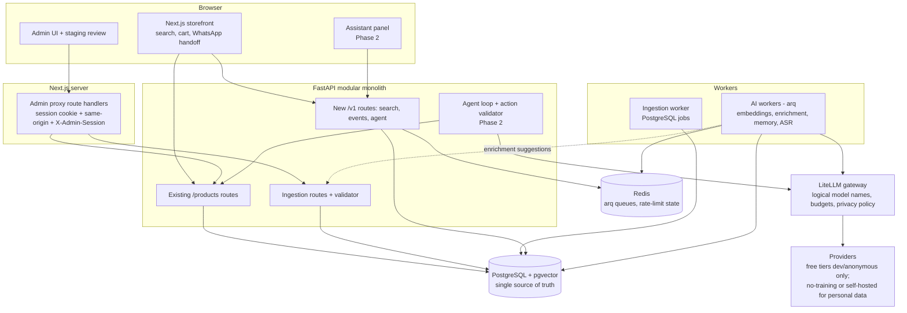

# Elegance Architecture

**Purpose and audience.** This is the authoritative architecture reference for maintainers, reviewers, operators, and future contributors. It records repository-backed facts, accepted boundaries, safety gates, and proposed phases. It is not a deployment log or a promise that target-state components are running.

The detailed roadmap lives in [`plans/ai-platform.md`](../plans/ai-platform.md); ingestion detail lives in [`phase-1-one-source-ingestion.md`](phase-1-one-source-ingestion.md). Deployment identifiers and release SHAs belong in release records, not here. Statements under **Current state** are verifiable in this repository; **Target state**, **Planned**, **Deferred**, and **Blocked** describe decisions or work that is not yet complete.

**Current high-level position (reviewed 2026-11-09).** The catalogue, PostgreSQL-backed ingestion/review flow, server search, validated assistant/enquiry seams, admin accounts, and provider-neutral customer-memory contract are implemented to varying levels of QA. Customer authentication is configuration-gated and disabled by default. Server-side cart, orders, payments, HubSpot sync, and production memory activation are not implemented. AI release readiness remains `false` until the relevant evaluation and privacy gates pass.

## 1. Current state

Phase 0.5 (one-source ingestion) implementation is present in the repository; its independent staging QA status is tracked separately. The Phase 0 foundation (local PostgreSQL + pgvector, Alembic schema, Redis/arq worker, LLM gateway with fake provider, events endpoint, tracing, evaluation runner) is implemented (S1–S4 of the PostgreSQL consolidation passed independent QA; S4, the MongoDB removal and PostgreSQL-only operational cleanup, is closed; S5 implementation evidence exists: the PostgreSQL backup/restore tooling and disposable restore-drill foundation are built, but nothing is activated and final independent S5 verification is pending), no agent, search, memory or voice feature exists yet, and PostgreSQL is the sole database: MongoDB has been removed from the code, dependencies, compose and CI (S4).

| Component | Responsibility |
|---|---|
| `apps/frontend` | Next.js 16 storefront and admin UI. Cart lives in `localStorage`; the cart builds a WhatsApp message and the order happens off-platform. Admins sign in with individual accounts; the opaque server-side session token lives in an HttpOnly cookie. Admin browser calls go only to Next route handlers (`proxyAdminRequest`), which enforce same-origin on writes and forward the token to the backend as `X-Admin-Session`; the browser never calls backend admin routes. |
| `apps/backend` | FastAPI API (Python 3.11, SQLAlchemy/asyncpg over PostgreSQL via `repositories/`). Public routes under `/products/...`, admin routes under `/products/admin/...`, ingestion routes under `/products/admin/ingestion/...`. Admin identity (3.9): individual accounts, roles and a durable audit log. Rate limiting, request logging, `/health/` (liveness, dependency-free) and `/ready/` (PostgreSQL ping; 503 when it is down). |
| Ingestion worker | Separate process (`python -m ingestion.worker`, or `--once` for the bounded monthly refresh) consuming PostgreSQL-backed `ingestion_jobs` (`FOR UPDATE SKIP LOCKED` claims, leases, heartbeats, bounded retries). |
| PostgreSQL + pgvector | The sole database and a hard dependency: catalogue, staged products, ingestion jobs, audit trail, plus the platform tables (customers, identities, conversations, messages, tool calls, events, audit log, outbox contract) in `models/relational_model.py`, Alembic in `migrations/`. In `compose.yaml` (internal network, no published port, least-privilege app and backup roles) and, for local work, `compose.ai.yaml`. |
| Redis + arq worker (local) | New AI workloads only (`workers/`), plus shared rate limits with in-process fallback. Separate from the ingestion worker. |
| `llm/`, `evals/`, `observability/tracing.py` | LiteLLM gateway wrapper (fake provider; real providers need `requirements-llm.txt`), recorded-response eval runner, and PII-scrubbed tracing with exporters off by default. |
| `compose.yaml`, `compose.local.yaml` | postgres, backend, frontend, Caddy proxy, and a `migrate` one-shot job (profile `tools`, operator-run). Only the proxy publishes ports. |
| `compose.ai.yaml` | Local-only PostgreSQL, Redis, migration job and worker on an internal network; not a production file. |
| `deploy/` | Caddyfile, PostgreSQL role bootstrap (`deploy/postgres/init-roles.sh`), rollback and watchdog scripts. PostgreSQL backup/restore tooling lives in `apps/backend/backup/` and `scripts/pg_backup.py`, with `deploy/postgres/container-pg.sh` (issue #105, M1-S5; not activated, see `OPERATIONS.md`). |
| `quill-store` (reference repo) | Source of the scraper helpers ported into `apps/backend/ingestion/`. Not deployed, never a second product store. |

The API is authoritative for publication state. Neither the crawler, a browser, the AI layer nor any external tool may make a product public.

### 1.1 Existing ingestion and approval pipeline (preserved)

```text
source -> ingestion job -> safe fetch -> deterministic extraction -> normalisation
       -> staged_products (pending_review) -> human review -> approve -> products (draft) -> manual publish (active)
```

- **Safe fetch:** `SafeFetcher` pins DNS to a validated public address, revalidates every redirect hop, enforces an exact host allowlist, size and time limits.
- **Deterministic extraction:** `ShopifyHtmlExtractor` (JSON-LD, then meta tags, then selectors, then labelled spec lines). No LLM. Unknown fields stay unknown.
- **Staging and review:** nothing enters `products` directly. Approval requires a human-entered PKR price, acknowledged stock and at least one image. Scraped stock is unknown and starts at 0.
- **Publish:** the only path to public visibility (`is_active=true`, `status="active"`).
- **Job system:** PostgreSQL-backed leases, bounded retries with exponential backoff, state machine in `schemas/ingestion_schema`.
- **Source controls:** ingestion stays off until an operator sets `INGESTION_SOURCE_DOMAIN` and `INGESTION_SOURCE_AUTHORIZED=true`, staging first.

This pipeline is preserved unchanged. AI enrichment later becomes a producer of items for this same review flow (see 3.4).

## 2. Target state



Reading the diagram:

- The catalogue, staged products and ingestion jobs are in PostgreSQL (3.1), next to the AI-platform data (customers, conversations, events, audit).
- Ingestion jobs are not on Redis (3.3).
- The dotted line is the only way AI touches the catalogue: suggestions enter the existing staged-product review. The AI layer has no publish path.
- Every box labelled Phase 2 or arq does not exist yet.

## 3. Architecture decisions

This section replaces separate ADR files. New decisions are added here (with date and status), not as new documents.

### 3.1 Database: PostgreSQL is the sole source of truth (accepted; owner decision 2026-10-29 supersedes the gated switch)

Target: PostgreSQL 17 with pgvector holds products, variants, staged products, ingestion jobs, catalogue attributes, embeddings, customers, conversations, events, enquiries and audit records. A permanent dual-source catalogue is not an option unless this section is changed explicitly.

**Owner decision.** MongoDB may be removed completely. The current Mongo data is disposable: no production data migration, no archive and no identifier preservation are required. This replaces the earlier gated switch (archive, equivalent records, 24-character IDs, staging verification, backup verification). What remains is ordinary engineering discipline:

1. a single cutover with no dual-write period and no feature flag; Mongo code is removed only after the PostgreSQL implementation passes its tests;
2. `staged_products` and `ingestion_jobs` move with the catalogue, because approval links them; the ingestion pipeline, human approval and manual publish are preserved unchanged in behaviour;
3. public IDs become UUIDs and the API keeps the `_id` JSON field for compatibility, **subject to a read-only check that the Quill integration persists no Elegance product IDs** (if it does, a compatibility mapping is added instead of changing IDs blindly);
4. tests: the default suite stays container-free (`pytest -q`); real-PostgreSQL tests run under `pytest -q -m integration`;
5. the work is a separate scoped issue and sequence, delivered in reviewable slices; it does not deploy anything and does not change staging or production;
6. backup and restore for PostgreSQL stay in the approval-gated operations workstream (#105); the Mongo backup tooling was removed (S4) and replaced by the M1-S5 PostgreSQL foundation: encrypted backup, verify, freshness check, retention and a restore drill into a disposable database, with implementation evidence from disposable containers only. It is **not activated**: no real off-server destination (only a local directory for tests and drills), no credentials or secrets provisioned, no scheduling, no alerting, no hosted or production restore, and no owner approval. #105 activation remains a launch prerequisite, and until it is done and a drill on a real off-server copy has passed, no document may claim an activated off-server or production backup service, or usable off-server backups, exists.

**Status.** The runtime cutover (S3) passed independent QA: routes, ingestion pipeline, worker and refresh run on PostgreSQL, and `/ready/` is gated by it. Removal (S4) deleted `database/db.py`, `utils/bson.py`, the Mongo product builder, the legacy Mongo import script, Motor/PyMongo/mongomock, the Mongo compose service, init script, backup scripts and CI variables; `compose.yaml` now provides PostgreSQL. Nothing has been deployed.

**Migrations.** Alembic is operator-owned: the application never migrates on start; `docker compose --profile tools run --rm migrate` applies `alembic upgrade head`; against staging or production it needs separate written approval (`DEPLOYMENT.md`, "Database migrations"). Only local or throwaway databases are migrated without approval.

The `outbox` contract table is for the future embedding worker; nothing writes to it yet. `/ready/` reports PostgreSQL and returns 503 when it is down: the catalogue needs PostgreSQL, whereas Redis, the worker and every AI dependency stay optional.

### 3.2 Backend shape and API (target decision; flat modular-monolith layout retained)

Modular monolith with bounded worker processes. The current flat package layout (`routes/ schemas/ models/ ingestion/ security/ database/ observability/ utils/`) is intentionally retained. Modularity is enforced through bounded package responsibilities and import boundaries, not through an `app/<module>/` prefix, and no such migration is required for the current roadmap. Imports stay top-level module style (run from `apps/backend`) and `main:app` stays the entrypoint. The existing `ingestion` package remains stable. New capabilities (`events`, `audit`, `identity`, `agent`, `memory`) may be added as bounded top-level packages in the phase that needs them. Any future package restructuring requires a separate scoped issue. New endpoints live under `/v1`. Existing `/products/...` routes and response shapes (`{items, next_cursor}`) remain compatible; versioning them is a separately scoped migration. New frontend admin calls follow the existing server-side proxy pattern, and the browser never receives backend admin credentials.

### 3.3 Queues: PostgreSQL-backed ingestion jobs coexist with Redis/arq (accepted)

| System | Used for | Status |
|---|---|---|
| PostgreSQL `ingestion_jobs` + `ingestion.worker` | Source ingestion and the monthly refresh | Exists. Same queue model as before (leases, heartbeats, bounded retries); only the store changed. |
| Redis + arq | New AI workloads only: embeddings, enrichment, memory, ASR | Planned (Phase 0H). Separate named queues, bounded concurrency, bounded retries. |

Two queue systems is a deliberate, documented cost. Migrating ingestion to arq is a separately scoped and verified task, not a side effect of any other slice. Redis also backs shared rate-limit state, with in-process fallback when Redis is unavailable (the API must stay functional if Redis is down).

### 3.4 AI enrichment feeds the existing review flow (accepted)

AI-suggested attributes, descriptions and SEO text are written as suggestions into the staged-product review path, with provenance (`visual_suggestion`, `supplier_declared`, `staff_approved`, `imported`), and need human approval. No parallel enrichment-publishing path. No automatic publication. Fabric, composition and authenticity come only from supplier or staff data, never from image guesses; unknown stays unknown. Reuse the existing staged-product state machine rather than adding a new one.

### 3.5 AI safety rules (accepted)

- Hard constraints are enforced by application code, never by the model. A product matches only when all hard constraints hold on the same purchasable variant; hard constraints are never relaxed automatically.
- Prices, stock, product IDs and availability come from live catalogue tools, never model text.
- The model proposes; application code validates. All tools use schema validation and allow-lists.
- Product descriptions and customer content are data, not instructions.
- Actions carry IDs, are replay-protected and expire where applicable. The assistant never declares an order confirmed, publishes a product, or sends WhatsApp messages by itself.
- AI degrades to normal browsing and search when unavailable. The catalogue must work with every AI dependency down.

### 3.6 AI provider and privacy policy (accepted)

- All model calls go through a LiteLLM gateway using logical names; keys are environment-only, never in code, frontend bundles, logs or committed files.
- Advisory model discovery is admin-only at `GET /v1/llm/models`, with operator refresh at `POST /v1/admin/llm/models/refresh`; Groq and Gemini metadata is normalized and cached in Redis (or an in-process fallback). Discovery never changes either configured chain. Fresh data is served for six hours and last-known-good stale data for up to 48 hours; the existing arq worker performs the scheduled refresh.
- Free-tier providers (Groq, Gemini free, OpenRouter free) are for development and anonymous product search only. A call flagged `personal=True` must never reach a provider that may train on inputs.
- **Privacy gate:** customer memory and personal conversations are postponed until the agent and memory extraction run on a paid no-training or self-hosted model and the gate is explicitly passed.
- Memory requires view, correct, delete and disable, tombstone protection, and protection against queued jobs recreating deleted items.
- The explicit memory API uses the `MemoryProvider` contract with the current PostgreSQL adapter. Provider operations receive only the server-resolved customer id, return public memory fields, and keep consent, audit and content-scrubbing rules in one transaction. No extraction or alternate provider is enabled by this contract.
- Raw audio is deleted after transcription by default.
- Per-environment and daily budgets, warning at 80%.

### 3.7 Evaluation gates (accepted)

AI releases are gated by evals. An empty or missing dataset reports "not evaluated", which blocks AI release readiness; it is never a pass. Normal pull requests use recorded responses, not live provider calls.

**Current status: `release_ready=false`, by design (issue #138).**

- **Suites and features.** `evals/thresholds.yaml` lists the suites; `evals/release_profile.yaml` is the reviewed, intended release configuration. A suite is *required* when the feature it guards is scheduled there; suites of unscheduled features still run and are reported as advisory, so disabled features never block unrelated development, while scheduling a feature cannot skip its evaluations.
- **Real evidence only.** `filter_parsing` and `variant_constraints` run the production parser and matcher against `datasets/filter_parsing.jsonl` and `datasets/retrieval_constraints.jsonl` (source `code`). `retrieval`, `grounding` and `action_safety` have no scorer or no data and report `NOT_EVALUATED`. They are advisory until their features are scheduled.
- **Release readiness** (`python evals/run_evals.py --release-ready`, exit 3 while blocked) is VERIFIED, not declared, and judges only the canonical files next to the script: `--thresholds`, `--profile` and any other `--root` are refused (exit 2) with `--release-ready`. It needs every required suite passing, every scheduled feature to have suites, an unchanged `artifact_manifest.json` (which pins `thresholds.yaml` and `release_profile.yaml` too), a signed review record per required suite (`evals/attestations/<suite>.json`: exact dataset sha256, `held_out` split, reviewer string different from the author string, no query overlap with any other dataset) and a signed owner approval of the exact candidate (`evals/approval.json`, bound to a digest of thresholds, profile, manifest and attestations). Records are HMAC-signed with keys (`EVAL_REVIEWER_KEY`, `EVAL_OWNER_KEY`, at least 32 characters, different from each other) taken from the verifier's environment and never committed, so editing YAML or JSON in the repository cannot produce `release_ready=true`. Errors while verifying a record, the manifest, the YAML configuration, scored rows or datasets (bad JSON, odd characters, deep nesting, unreadable files) are caught and reported as a verification failure or configuration error, and devices, FIFOs and loops named like a dataset are refused unread: the gate fails closed. Exotic untested inputs may still raise; any such crash exits non-zero and is never ready. **Limits, stated plainly:** (1) the keys are symmetric: whoever can verify can sign, and there is no rotation or revocation; (2) a valid signature proves a key holder wrote the record, not that the labels were truly reviewed; (3) `author` and `reviewer` are free text inside the signed payload, compared as skeletons (Unicode NFKD, invisible and combining characters dropped, case folded, a small built-in table of look-alike letters mapped to Latin, punctuation and whitespace collapsed), so the code cannot tell apart two different names for one person ("Alice" vs "Alice B.") and real independence rests on who holds the reviewer key and on the review workflow (#139); (4) the leakage check reduces every string under the keys `query`, `q`, `text`, `transcript`, `utterance`, `input`, `prompt`, `question` (any depth, lists included) and every other string of three or more words to the same skeleton, and compares it with every `.jsonl`, `.ndjson` and `.json` file below `datasets/` (symlinked directories followed once) and, by whole-word containment, every `.txt .csv .tsv .yaml .yml .md` file there; it does not see paraphrases or translations, one- and two-word strings under other keys, look-alike letters outside the small table, files with other extensions, or anything outside `datasets/`. Invisible format characters are read both as nothing and as a space (a zero-width joiner between words is a leak either way); any file with a scanned suffix under `datasets/` is read, so prose such as a README that mentions a query word, or a stray non-UTF-8 or non-JSON `.json` file, blocks release (keep `datasets/` for data); symlinked directories are followed with no size cap; names that differ only by a vowel sign or that are pure punctuation compare equal (fail closed) while look-alikes outside the small table compare different. Limits must be finite and non-negative numbers (`NaN` and negatives are configuration errors) and duplicate YAML keys (including falsy ones) and YAML merge keys (`<<`) in thresholds or profile are configuration errors, and a thresholds or profile path that is not a regular file is refused unread. A run on any non-canonical root or with overrides never reports `release_ready=true`. Today no record exists and no dataset qualifies as held-out (the two required datasets even share queries with each other and with other datasets, which is reported, not edited away), so the gate is closed. Issue #139 builds the review workflow; Urdu/Roman Urdu review needs a fluent human reviewer, an open blocker. `evidence` and `approval` are not configuration keys; unknown keys are configuration errors.
- **Activation checks.** `evals/tests/test_release_profile.py` fails when a backend boolean setting is unclassified or listed under two features, `scheduled` is not a real boolean, or a setting is on by default or enabled in the Dockerfile (several `ENV` pairs per line, continuations), any compose `environment` (map or list, `${VAR:-default}`) or env example with any truthy spelling (`true/1/yes/on`) while its feature is unscheduled; a flag-shaped variable that is not a known setting also fails. These are CI tests: they raise the cost of an accidental activation, they do not stop someone who edits the tests, and runtime flags set outside the repository are not seen. A missing profile or manifest drift is a configuration error (exit 2), never a weaker gate. Known dataset defects (fp-005) are listed in `evals/KNOWN_DATASET_ISSUES.md`.
- **Deterministic artifacts.** Frozen gold data and thresholds are pinned by SHA-256 in `evals/artifact_manifest.json` (`python evals/artifact_manifest.py`); no test depends on git history. `thresholds.yaml` and `release_profile.yaml` are in the manifest, so loosening a limit or scheduling a feature is a visible manifest change and also invalidates any owner approval.
- No AI feature or provider is release-ready until required evidence exists and the provider and privacy gates (3.5, 3.6) are met. These results are not to be edited or inferred into a pass.

### 3.8 Phase naming and decision register

Phase 0.5 is the one-source ingestion implementation present in the repository; independent staging QA remains tracked separately. AI phases: 0 Platform foundation, 1 Catalogue intelligence, 2 Agentic UI, 3 Identity and memory, 4 Voice, 5 Operational maturity.

| Topic | Decision | Where |
|---|---|---|
| Single database | PostgreSQL only; Mongo removed (S4) | 3.1 |
| Queues | PostgreSQL jobs for ingestion, Redis/arq for new AI work | 3.3 |
| Layout and API | Modular monolith, `/v1` for new routes, old routes untouched | 3.2 |
| Enrichment | Produces suggestions into the existing review flow | 3.4 |
| LLM gateway and privacy | LiteLLM, privacy gate before memory | 3.6 |
| Evals | "Not evaluated" blocks release | 3.7 |
| Admin identity | Individual backend accounts (roles, scrypt hashes, opaque server-side sessions, audit log); see 3.9. The shared `ADMIN_API_KEY` survives only as an expiring legacy fallback. Keycloak remains optional and undecided | Implemented (M1-S3); Keycloak open (section 6) |

### 3.9 Admin identity: individual accounts (accepted, implemented in M1-S3)

- **Accounts and roles:** `admin_accounts` rows with a role of `viewer` (read), `editor` (read and write the catalogue) or `owner` (also `accounts:manage`, `audit:read`, `platform:operate`). Passwords are stored as scrypt hashes; login locks an account after repeated failures. The last active owner cannot be demoted or disabled.
- **Sessions:** login issues an opaque token (`es1.` prefix); only its SHA-256 is stored in `admin_sessions`. The backend checks expiry, revocation and account status on every request, and revokes sessions on logout, password change, role change and disablement.
- **Trust boundary:** the browser holds the token only in the HttpOnly `es_admin_session` cookie and never calls backend admin routes. Next route handlers (`/api/admin/...`) sign in, enforce same-origin on writes and forward the token as `X-Admin-Session`. The backend authorizes default-deny by method and permission (`security/admin_auth.require_permission`).
- **Audit:** every authorised mutation is written to the append-only `audit_log` before the handler runs and finalised to success or failure; a failed audit write refuses the mutation (503). Denied and unauthenticated attempts are recorded. Rows attribute the actor by account UUID.
- **Bootstrap:** no default credential. After `alembic upgrade head`, an operator runs `python scripts/admin_accounts.py bootstrap-owner --email <addr>` (idempotent; `reset-password` for recovery). Owners create further accounts.
- **Legacy fallback:** `X-Admin-Key` with `ADMIN_API_KEY` is accepted only while `ADMIN_LEGACY_KEY_EXPIRES_AT` (ISO 8601 with offset) is in the future. It acts as `editor` plus `platform:operate`, cannot manage accounts or read audit, and is audited as `legacy-shared-key`. Retirement: empty both variables or let the instant pass; no code change or redeploy of code is needed.

### 3.10 Customer principal/session for memory routes (M4)

- **What exists (verified in the repository):** admin identity from 3.9 remains separate. Customer identity verification and hash-only server sessions exist behind `CUSTOMER_AUTH_ENABLED` and complete provider configuration; they are disabled by default. The public assistant and action `session_id` is only a conversation/idempotency label, never a customer identity.
- **Boundary:** customer memory routes depend on `memory.principal.current_principal`. A `CustomerSessionVerifier` confirms a server-held live session for the opaque `X-Customer-Session` token and returns a `CustomerPrincipal` (customer id, session id, SHA-256 of the presented token, timezone-aware expiry). The seam re-checks token binding, expiry and types, and answers an identical 401 for absent, invalid, expired, mismatched, oversized or erroring verification. Client-supplied ids, headers, query, cookie or body fields are never an identity.
- **Activation:** the existing external-token exchange is a configuration-gated authentication primitive; this contract work does not enable customer memory or change the privacy gate, consent, ownership isolation, audit or retention requirements.
- **Bounded expansion:** the idempotent work order, exact task IDs, synthetic-only Batch A login/merge gate, synthetic-only Batch B explainable recommendation gate, and blocked Batch C privacy gate are recorded in [`docs/m4-contract.md`](./m4-contract.md). Batch 1 (`t_2f755ea0`) and M3 remain preserved; no batch may set `release_ready=true` or promote to `main`.
- **Batch A backend implementation (not independently QA-approved):** deterministic Google/phone OTP adapters live only under tests. Verified issuer and subject are bound in the stored identity key; optional exchange idempotency keys refuse replay without issuing a second session. The disabled-by-default staging-only merge API attributes at most 100 recent signed-session anonymous events to a live customer after explicit consent, with a unique ledger and same-transaction audit. It never writes memory. See [`M4_BATCH_A_BACKEND.md`](./M4_BATCH_A_BACKEND.md) for limits and migration notes.

#### Current M4 milestone status — 2026-11-08

The provider-training policy and migration downgrade fixture are present in staging. The evidence lineage is PR #179 → merge `e04fb7470fb921032086f8c99217247458efec1d`, PR #184 → staging promotion `3b4f7b10d953a5e30cde50a7b2c714f59f43bc8d`, PR #185 → migration fixture merge `5a6ed21a5665d254ac345749811efa9dc63a8722`, and PR #186 → historical staging promotion `d020d521f2666726a2b82316785c8bf72669e83a`; PR #194 is the current documentation reconciliation at `origin/staging-integration` `63f1730663114d31085967ae01a05687bd614979`, while `origin/staging` is `e5c04c8d4097a46adf9fecf00baddd15cc860fc2` and `origin/main` remains `283b27eee90533435ef3b2e28e6a3823ee1c5d23`.

Independent QA recorded M4 `119 passed, 29 deselected`, migration promotion `23 passed, 2 warnings`, and targeted migration suites `70 passed`. Local disposable Redis and arq verification passed: Redis was healthy at `127.0.0.1:6380`, readiness at `127.0.0.1:18000` reported database/PostgreSQL, Redis, and worker connected, and the synthetic job completed `queued → deferred → queued → complete` on attempt 2. Groq was exercised only through two bounded synthetic calls; no secrets or API keys are documented.

This remains a staging/non-production milestone. Deployment, production activation, provider selection/credentialing, and `release_ready` remain deferred. Remaining blockers: frontend live proxy needs a disposable backend URL; embeddings activation/backfill is unavailable; evaluation provenance is incomplete; and external observability has not been exercised.

### 3.11 Canonical embedding and retrieval architecture (accepted; implemented on `staging-integration`)

The consolidation briefly carried two embedding pipelines. The **canonical configured pipeline** is the evaluated multilingual E5 pipeline of `search/`, `embeddings/` and `repositories/embeddings.py`. EmbeddingGemma is a separately verified local-only candidate for search; it is not the canonical E5 configuration and is not memory-extraction or production approval.

#### EmbeddingGemma 2 candidate — verified local-only boundary (2026-11-08)

The staging-integration candidate contract additionally verifies `google/embeddinggemma-2` for the local search path: Hugging Face revision `f9972ac22e696a105c482202646979e33e4b5a1e`; model-tree SHA-256 `8338594ef62c913285891b775b6c3084e518001f499c1f97df61904c57ad708b`; weights SHA-256 `197a32965d4b1105faf060417baa899e193fb73cd401f42ec9295234d5553d79`; 768 dimensions; CPU-only. The candidate quality record reports recall `0.9973`, MRR `0.9706`, synonym recall/MRR `1.0`, zero hard-constraint violations, and reproducibility Jaccard `1.0`.

Independent QA is recorded as Gemma/contract `35 passed, 1 skipped`, evaluation `14 passed`, embedding integration `21 passed`, schema integration `6 passed`, compileall/diff-check passed, and disposable database backfill `8/8` with an idempotent rerun and semantic retrieval pass. This evidence verifies the pinned local candidate and its search/backfill contract only. It does **not** verify hosted staging acceptance, external OTLP/Langfuse, reviewed model/evaluation provenance beyond the recorded candidate evidence, deployment, production activation, memory extraction, or `release_ready`; the activation boundary remains local-only until those gates are separately cleared.

**Model and configuration.** `intfloat/multilingual-e5-base`, 768 dimensions, CPU, offline, loaded from a pinned local snapshot (`embeddings/providers/local_e5.py`; the staging image bakes it in). Settings: `EMBEDDING_ENABLED`, `EMBEDDING_PROVIDER` (`local_e5`; `fake` for tests), `EMBEDDING_DIMENSIONS=768`, `EMBEDDING_INDEX_VERSION`, `LOCAL_SEMANTIC_SEARCH_ENABLED`, `LOCAL_E5_MODEL_PATH`, `LOCAL_E5_MODEL_REVISION` (tree digest). Unset or wrong means disabled; nothing blocks start-up or catalogue browsing.

**Representations.** `search/representations.py` (`catalog-text-v1`): a *product* text (name, category, material, description, approved attributes) and a *variant* text (product name, variant name, colour, category, material, approved attributes). Private, price, stock, URL and staged fields are excluded by construction. Over-long text fails loudly instead of being truncated. Queries use the E5 `query:` prefix, documents the `passage:` prefix.

**Storage.** `product_embeddings` and `variant_embeddings` (migration 0009): vector(768) with HNSW cosine indexes. A row is identified by owner + representation version + provider + model + model revision + index version, so a different model, revision or index version is a different row and vectors from different spaces are never compared. The row is also the job (`queued, running, succeeded, failed, stale`) with a lease, attempt counter, bounded retries and backoff.

**Lifecycle.** `embedding_service.ensure_pending` creates the row idempotently (unique identity key, `ON CONFLICT DO NOTHING`), `process` claims it under a lease, re-reads the live source, embeds through `embed_checked` (validated input, bounded time, validated finite vector of the right width), and completes under a row lock; a source that changed meanwhile ends `stale`. Run it via `scripts/embedding_backfill.py --kind product|variant --limit N [--after UUID]` (bounded, resumable, idempotent: finished rows are skipped) or the `embeddings` arq queue (`workers.settings.EmbeddingWorkerSettings`, deterministic job id per row so duplicate enqueues are no-ops).

**Freshness.** Searchable means: succeeded, source revision equals the product's current revision, product active (variant active), identity matches the active provider/model/revision/index, and the stored representation hash still equals the hash of the live content. A catalogue edit therefore removes the old vector at once and a re-embed makes the new one searchable.

**Retrieval.** Three public contracts, all reading the same vectors:

| Endpoint | Strategy | Fusion |
|---|---|---|
| `GET /v1/search` and the assistant | SQL-filtered lexical pool + nearest vectors (`repositories/hybrid.py`) | weighted RRF (`semantic/ranking.py`, K=60, default 1:1), keyset cursor bound to query, filters, weights and embedding space; off-topic queries without a shopping word keep only neighbours within `SEMANTIC_MAX_DISTANCE` |
| `POST /v1/search/hybrid` | exact parser filters first, then lexical top-K + vector top-K of the eligible products (`search/hybrid.py`) | fixed RRF (K=60), cursor bound to the search/index version |
| `POST /v1/search` | deterministic constraints only, no model | none |

The two RRF implementations are intentionally different strategies (weighted over a SQL pool, versus fixed over an eligible set) and are kept; the third, unused one (`semantic/fusion.py`) was removed. All three apply hard filters first: inactive products and unavailable variants never appear, colour/price/stock are satisfied by the same variant, results are de-duplicated per page and ordered deterministically. Without a query vector (disabled, blank, provider failure, wrong width) they return lexical results; a stale or zero vector is dropped, never guessed.

**Retired.** `semantic/{local_e5,backfill,fusion}.py`, `repositories/semantic_embeddings.py`, `scripts/semantic_backfill.py`, the `embedding_backfill_job` arq job and the `SEMANTIC_*` embedding settings are gone. `semantic/embeddings.py` and `semantic/representation.py` remain only as the offline evaluation contract (`evals/semantic_eval.py`, enrichment).

**Legacy tables.** `semantic_embeddings` and `semantic_embedding_jobs` (migration 0012) are no longer read or written by any code and are empty on every database created from this chain. They are kept deliberately: dropping persisted tables needs a separately approved migration (a future `0016`).

**PostgreSQL schema and migrations.** One linear chain, single head `0016`: 0001 relational foundation, 0002 outbox, 0003 catalogue, 0004 ingestion, 0005 outbox uuid, 0006 job retryability, 0007 catalogue attributes, 0008 enrichment suggestions, 0009 embeddings + search (main's chain ends here), 0010 admin accounts (also adds `audit_log.outcome/detail` and the append-only guard), 0011 enquiries, 0012 semantic embeddings (legacy, see above), 0013 action executions, 0014 customer memory, 0015 customer sessions, 0016 anonymous merge ledger and optional exchange replay hash. 0010-0016 only add tables or nullable columns, apart from the two nullable/defaulted `audit_log` columns and the guard trigger of 0010.

**Safe upgrade of an existing database** (never against production or a shared database without the approval in section 5):
1. Take a verified backup (`pg_dump -Fc`) and restore it into a scratch database first.
2. `python scripts/check_migration_stamp.py` (read-only). Exit 3 means the database carries the pre-consolidation numbering: do not stamp, do not upgrade; recreate a disposable database, or restore into a new one.
3. `alembic current` must print `0009` (or later). `alembic upgrade head` applies 0010-0016 in one pass; each step has a downgrade, but `0010` drops `audit_log.outcome/detail` data, `0016` refuses downgrade with merge evidence, and other downgrades drop customer-owned tables, so rollback means restoring the backup, not downgrading.
4. Run `python scripts/embedding_backfill.py --kind product --limit N` (and `variant`) until `last_id` is empty; search stays lexical until vectors exist.

**Known limitations.** Freshness is verified per candidate (about two reads per vector candidate; fine at the current catalogue size). `POST /v1/search/hybrid` has no relevance gate, so an off-topic query still returns the nearest products (the GET path gates them). Only one model and one index version are searchable at a time; switching means a new index version plus a backfill.

### 3.12 WhatsApp bridge (accepted, optional, off by default; owner decision 2026-11-06)

`WHATSAPP_BRIDGE_ENABLED=false` keeps the `wa.me` link flow unchanged. When `true`, a self-hosted Node/Baileys bridge (`apps/whatsapp-bridge`, linked-device, no Meta Business Platform) publishes chats to the Redis stream `wa:inbound`; a Python consumer (`whatsapp/`) stores each message once (migration 0019), links it to an enquiry by `Ref`, marks the enquiry `contacted` on a staff reply, and answers with reviewed templates. **Reply automation stays on this bridge** (the Cloud API is the official fallback if the number is restricted). Boundaries: the bridge owns no SQL or business logic; `/send` refuses chats without a customer message in the last 24 hours, so the bot never starts a conversation; automatic replies never state an order is confirmed (a staff button does); the WhatsApp assistant is model-driven (`whatsapp/assistant.py`, prompts in `whatsapp/templates/assistant.yaml`): a model reads the scrubbed message and recent chat, chooses search/order/details/reply/handoff, and code grounds it (products, prices, stock and links come from the database; the enquiry goes through the website's validating `create_enquiry`; nothing is placed until the customer confirms a summary; replies with unknown links are dropped). Outside development customer text goes only through the gateway's no-training chain (`LLM_PRODUCTION_CHAIN`, section 3.6 gate); with no chain, or on any model failure, the holding reply is sent and a person follows up; voice notes are transcribed only by a declared self-hosted or no-training endpoint and the audio is discarded; Baileys auth state is file-based by default or an encrypted PostgreSQL table with its own role (migration 0020). Retention 12 months with a deletion command. Operations: `OPERATIONS.md`, `LAUNCH_RUNBOOK.md` section 6, `DEPLOYMENT_VALIDATION.md`. Known limits and shortcuts are listed in `OPERATIONS.md`. Nothing is deployed or enabled.

## 4. Phased roadmap and acceptance gates

A phase is complete only with implementation evidence, passing acceptance criteria, current documentation, a checked rollback/degradation path and independent QA of the intended surface. Own unit tests are not independent QA.

| Phase | Scope | Gate to start | Acceptance gate |
|---|---|---|---|
| 0.5 | One-source ingestion with human approval | Existing implementation | Independent staging QA record (`docs/qa/phase-1-handoff.md`) |
| 0 | Foundation, in order: this document; backend structure; local PostgreSQL + pgvector; SQLAlchemy + Alembic; initial relational schema; integration tests; eval runner; Redis/arq worker; LiteLLM gateway; interaction events; observability; documentation alignment | This document agreed | Existing suites unchanged and green; `/health/` dependency-free; catalogue works with PostgreSQL, Redis and LLM down; migrations reversible; no secrets in repo; independent QA |
| 1 | Catalogue intelligence and hybrid search: controlled English / Urdu-script / Roman Urdu vocabulary, attributes with provenance, variant-level filtering, lexical then evaluated semantic search, server-side pagination | Phase 0 acceptance and independent QA | Retrieval and constraint evals on a non-empty dataset |
| 2 | Agentic UI behind a feature flag | Phase 1 | Grounding and safety evals; replay and confirmation tests; graceful degradation |
| 3 | Identity and memory | Phase 2 and the privacy gate explicitly passed | Memory controls, tombstones, audit, privacy documentation |
| 4 | Voice (bounded audio, text fallback, faster-whisper) | Phase 3 | Task-success and critical-entity evals |
| 5 | Operational maturity | Per-workstream approval | See section 5 |

Phase 0 is local development and CI only. Nothing in it deploys or changes shared environments.

## 5. Approval boundaries

Without explicit written approval for the specific action, none of the following is done by implementation work:

- pushing to GitHub, merging to `main`, closing issues, changing branch protection or other GitHub settings;
- deploying, changing production, repointing or reconfiguring staging;
- changing DNS, hosting, Cloudflare, Render, Vercel, MongoDB Atlas, R2, or buying a VPS or any paid service;
- creating, rotating or reading credentials, creating provider accounts;
- enabling ingestion for a real source, or publishing catalogue content;
- sending real WhatsApp messages;
- deploying the PostgreSQL stack, running migrations against a shared environment, or decommissioning any hosted MongoDB/Atlas (3.1; the code removal itself is done), migrating ingestion to arq (3.3), enabling customer memory (3.6), enabling k3s, publishing GHCR images.

Operations workstreams #103 (CI images and security scans), #104 (environments), #105 (Postgres backups to R2; the code foundation exists, activation is still gated), #106 (VPS) and #112 (k3s/GitOps) are separate approval-gated tasks, prepared as plans and local validation only until approved.

## 6. Postponed and open

**Postponed, not designed here, not implemented without separate authorisation:** CRM and HubSpot, WhatsApp Business API automation, payments, full order management, multiple ingestion sources, the analytics data platform, custom Urdu ASR research.

**Open decisions:**

1. Admin identity: the lighter option (individual accounts with roles and audit) is implemented; whether Keycloak replaces it later is open. Retiring the legacy shared key is an operator step (empty `ADMIN_API_KEY` and `ADMIN_LEGACY_KEY_EXPIRES_AT`).
2. Whether the existing `/products/...` routes are ever versioned under `/v1`.
3. ~~When `staged_products` and `ingestion_jobs` move from Mongo~~ Resolved: with the catalogue (3.1).
4. Embedding model (shared multimodal versus separate), decided by retrieval evals including Urdu and Roman Urdu.
5. Stage 1 hosting for PostgreSQL and Redis (managed free tier versus later VPS); needs separate approval.
6. Whether `vercel.json` in the frontend is a live deploy path.

## 7. Relationship to other documents

| Document | Role |
|---|---|
| `plans/ai-platform.md` | Detailed roadmap, data model sketch, budget, risks. Where it names `docs/adr/...` files, the decision is recorded in section 3 here instead. |
| `plans/ai-platform-alignment-review.md` | Point-in-time comparison of the plan with the repo, with the decisions that section 3 now encodes. |
| `docs/phase-1-one-source-ingestion.md` | Ingestion states, rules and security model. |
| `README.md`, `DEPLOYMENT.md`, `OPERATIONS.md`, `LAUNCH_RUNBOOK.md`, `CLAUDE.md` | Setup, deploy and operations. Updated only when their commands, variables or procedures actually change. |

## Appendix A. Product quality control pipeline (carried over)

> Carried over unchanged from branch `docs/staging-first-release-workflow` during the staging-integration consolidation. It was written against an older numbering of this document (it was section 9.1 there); the content is current, only its heading numbers are not.

### 9.1 Product quality control pipeline

Product quality control is part of the ingestion foundation, not a later cosmetic AI feature. Every staged item should receive deterministic validation before it can be approved.

The first quality checks must use normal application code because it is cheaper, faster, predictable, and straightforward to test:

- Missing title, description, category, or required variant fields.
- Missing or invalid image URLs.
- Invalid price, currency, stock, or availability values.
- Broken product URLs or disallowed source domains.
- Duplicate source identity or likely duplicate content.
- Unsupported material, origin, or other ungrounded fallback values.
- Invalid variant combinations and malformed payloads.

Suggested quality states:

```text
CHECK_PENDING
  -> READY_FOR_REVIEW
  -> REVIEW_REQUIRED
  -> BLOCKED
  -> APPROVED
```

The admin review surface should show the failed rule, severity, source value, normalized value, and recommended next action. A corrected item must be revalidated before approval.

AI may assist only where it adds value:

- Suggest a missing description.
- Flag a possible category mismatch.
- Explain a possible duplicate.
- Propose translation or standardized copy.

AI suggestions remain drafts. AI must not replace deterministic validation or silently change a product.

- Deterministic product quality checks.
- Quality status, rule failures, and revalidation path.
