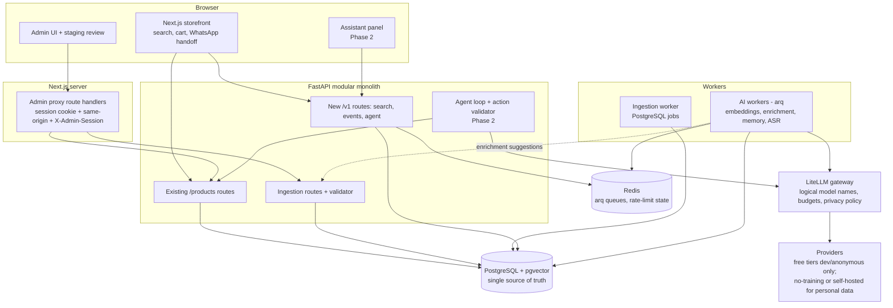

# Elegance Architecture

The single authoritative architecture document for Elegance Shawls: what exists today, where the system is going, and which decisions and approvals govern the path. The detailed roadmap lives in [`plans/ai-platform.md`](../plans/ai-platform.md) (v2.0); this document records the decisions, boundaries and gates, and does not duplicate that plan. Ingestion detail lives in [`phase-1-one-source-ingestion.md`](phase-1-one-source-ingestion.md).

Deployment identifiers and release SHAs belong in release records, not here. Statements under "Current state" are verifiable in this repository; everything under "Target state" is a decision, not a fact about running software.

## 1. Current state

Phase 0.5 (one-source ingestion) implementation is present in the repository; its independent staging QA status is tracked separately. The Phase 0 foundation (local PostgreSQL + pgvector, Alembic schema, Redis/arq worker, LLM gateway with fake provider, events endpoint, tracing, evaluation runner) is implemented (S1–S4 of the PostgreSQL consolidation passed independent QA; S4, the MongoDB removal and PostgreSQL-only operational cleanup, is closed; S5 final verification is pending), no agent, search, memory or voice feature exists yet, and PostgreSQL is the sole database: MongoDB has been removed from the code, dependencies, compose and CI (S4).

| Component | Responsibility |
|---|---|
| `apps/frontend` | Next.js 16 storefront and admin UI. Cart lives in `localStorage`; the cart builds a WhatsApp message and the order happens off-platform. Admins sign in with individual accounts; the opaque server-side session token lives in an HttpOnly cookie. Admin browser calls go only to Next route handlers (`proxyAdminRequest`), which enforce same-origin on writes and forward the token to the backend as `X-Admin-Session`; the browser never calls backend admin routes. |
| `apps/backend` | FastAPI API (Python 3.11, SQLAlchemy/asyncpg over PostgreSQL via `repositories/`). Public routes under `/products/...`, admin routes under `/products/admin/...`, ingestion routes under `/products/admin/ingestion/...`. Admin identity (3.9): individual accounts, roles and a durable audit log. Rate limiting, request logging, `/health/` (liveness, dependency-free) and `/ready/` (PostgreSQL ping; 503 when it is down). |
| Ingestion worker | Separate process (`python -m ingestion.worker`, or `--once` for the bounded monthly refresh) consuming PostgreSQL-backed `ingestion_jobs` (`FOR UPDATE SKIP LOCKED` claims, leases, heartbeats, bounded retries). |
| PostgreSQL + pgvector | The sole database and a hard dependency: catalogue, staged products, ingestion jobs, audit trail, plus the platform tables (customers, identities, conversations, messages, tool calls, events, audit log, outbox contract) in `models/relational_model.py`, Alembic in `migrations/`. In `compose.yaml` (internal network, no published port, least-privilege app and backup roles) and, for local work, `compose.ai.yaml`. |
| Redis + arq worker (local) | New AI workloads only (`workers/`), plus shared rate limits with in-process fallback. Separate from the ingestion worker. |
| `llm/`, `evals/`, `observability/tracing.py` | LiteLLM gateway wrapper (fake provider; real providers need `requirements-llm.txt`), recorded-response eval runner, and PII-scrubbed tracing with exporters off by default. |
| `compose.yaml`, `compose.local.yaml` | postgres, backend, frontend, Caddy proxy, and a `migrate` one-shot job (profile `tools`, operator-run). Only the proxy publishes ports. |
| `compose.ai.yaml` | Local-only PostgreSQL, Redis, migration job and worker on an internal network; not a production file. |
| `deploy/` | Caddyfile, PostgreSQL role bootstrap (`deploy/postgres/init-roles.sh`), rollback and watchdog scripts. No backup tooling yet (issue #105). |
| `quill-store` (reference repo) | Source of the scraper helpers ported into `apps/backend/ingestion/`. Not deployed, never a second product store. |

The API is authoritative for publication state. Neither the crawler, a browser, the AI layer nor any external tool may make a product public.

### 1.1 Existing ingestion and approval pipeline (preserved)

```text
source -> ingestion job -> safe fetch -> deterministic extraction -> normalisation
       -> staged_products (pending_review) -> human review -> approve -> products (draft) -> manual publish (active)
```

- **Safe fetch:** `SafeFetcher` pins DNS to a validated public address, revalidates every redirect hop, enforces an exact host allowlist, size and time limits.
- **Deterministic extraction:** `ShopifyHtmlExtractor` (JSON-LD, then meta tags, then selectors, then labelled spec lines). No LLM. Unknown fields stay unknown.
- **Staging and review:** nothing enters `products` directly. Approval requires a human-entered PKR price, acknowledged stock and at least one image. Scraped stock is unknown and starts at 0.
- **Publish:** the only path to public visibility (`is_active=true`, `status="active"`).
- **Job system:** PostgreSQL-backed leases, bounded retries with exponential backoff, state machine in `schemas/ingestion_schema`.
- **Source controls:** ingestion stays off until an operator sets `INGESTION_SOURCE_DOMAIN` and `INGESTION_SOURCE_AUTHORIZED=true`, staging first.

This pipeline is preserved unchanged. AI enrichment later becomes a producer of items for this same review flow (see 3.4).

## 2. Target state



Reading the diagram:

- The catalogue, staged products and ingestion jobs are in PostgreSQL (3.1), next to the AI-platform data (customers, conversations, events, audit).
- Ingestion jobs are not on Redis (3.3).
- The dotted line is the only way AI touches the catalogue: suggestions enter the existing staged-product review. The AI layer has no publish path.
- Every box labelled Phase 2 or arq does not exist yet.

## 3. Architecture decisions

This section replaces separate ADR files. New decisions are added here (with date and status), not as new documents.

### 3.1 Database: PostgreSQL is the sole source of truth (accepted; owner decision 2026-10-29 supersedes the gated switch)

Target: PostgreSQL 17 with pgvector holds products, variants, staged products, ingestion jobs, catalogue attributes, embeddings, customers, conversations, events, enquiries and audit records. A permanent dual-source catalogue is not an option unless this section is changed explicitly.

**Owner decision.** MongoDB may be removed completely. The current Mongo data is disposable: no production data migration, no archive and no identifier preservation are required. This replaces the earlier gated switch (archive, equivalent records, 24-character IDs, staging verification, backup verification). What remains is ordinary engineering discipline:

1. a single cutover with no dual-write period and no feature flag; Mongo code is removed only after the PostgreSQL implementation passes its tests;
2. `staged_products` and `ingestion_jobs` move with the catalogue, because approval links them; the ingestion pipeline, human approval and manual publish are preserved unchanged in behaviour;
3. public IDs become UUIDs and the API keeps the `_id` JSON field for compatibility, **subject to a read-only check that the Quill integration persists no Elegance product IDs** (if it does, a compatibility mapping is added instead of changing IDs blindly);
4. tests: the default suite stays container-free (`pytest -q`); real-PostgreSQL tests run under `pytest -q -m integration`;
5. the work is a separate scoped issue and sequence, delivered in reviewable slices; it does not deploy anything and does not change staging or production;
6. backup and restore for PostgreSQL stay in the approval-gated operations workstream (#105); the Mongo backup tooling has been removed (S4) and nothing replaces it until #105, which is a launch prerequisite.

**Status.** The runtime cutover (S3) passed independent QA: routes, ingestion pipeline, worker and refresh run on PostgreSQL, and `/ready/` is gated by it. Removal (S4) deleted `database/db.py`, `utils/bson.py`, the Mongo product builder, the legacy Mongo import script, Motor/PyMongo/mongomock, the Mongo compose service, init script, backup scripts and CI variables; `compose.yaml` now provides PostgreSQL. Nothing has been deployed.

**Migrations.** Alembic is operator-owned: the application never migrates on start; `docker compose --profile tools run --rm migrate` applies `alembic upgrade head`; against staging or production it needs separate written approval (`DEPLOYMENT.md`, "Database migrations"). Only local or throwaway databases are migrated without approval.

The `outbox` contract table is for the future embedding worker; nothing writes to it yet. `/ready/` reports PostgreSQL and returns 503 when it is down: the catalogue needs PostgreSQL, whereas Redis, the worker and every AI dependency stay optional.

### 3.2 Backend shape and API (target decision; flat modular-monolith layout retained)

Modular monolith with bounded worker processes. The current flat package layout (`routes/ schemas/ models/ ingestion/ security/ database/ observability/ utils/`) is intentionally retained. Modularity is enforced through bounded package responsibilities and import boundaries, not through an `app/<module>/` prefix, and no such migration is required for the current roadmap. Imports stay top-level module style (run from `apps/backend`) and `main:app` stays the entrypoint. The existing `ingestion` package remains stable. New capabilities (`events`, `audit`, `identity`, `agent`, `memory`) may be added as bounded top-level packages in the phase that needs them. Any future package restructuring requires a separate scoped issue. New endpoints live under `/v1`. Existing `/products/...` routes and response shapes (`{items, next_cursor}`) remain compatible; versioning them is a separately scoped migration. New frontend admin calls follow the existing server-side proxy pattern, and the browser never receives backend admin credentials.

### 3.3 Queues: PostgreSQL-backed ingestion jobs coexist with Redis/arq (accepted)

| System | Used for | Status |
|---|---|---|
| PostgreSQL `ingestion_jobs` + `ingestion.worker` | Source ingestion and the monthly refresh | Exists. Same queue model as before (leases, heartbeats, bounded retries); only the store changed. |
| Redis + arq | New AI workloads only: embeddings, enrichment, memory, ASR | Planned (Phase 0H). Separate named queues, bounded concurrency, bounded retries. |

Two queue systems is a deliberate, documented cost. Migrating ingestion to arq is a separately scoped and verified task, not a side effect of any other slice. Redis also backs shared rate-limit state, with in-process fallback when Redis is unavailable (the API must stay functional if Redis is down).

### 3.4 AI enrichment feeds the existing review flow (accepted)

AI-suggested attributes, descriptions and SEO text are written as suggestions into the staged-product review path, with provenance (`visual_suggestion`, `supplier_declared`, `staff_approved`, `imported`), and need human approval. No parallel enrichment-publishing path. No automatic publication. Fabric, composition and authenticity come only from supplier or staff data, never from image guesses; unknown stays unknown. Reuse the existing staged-product state machine rather than adding a new one.

### 3.5 AI safety rules (accepted)

- Hard constraints are enforced by application code, never by the model. A product matches only when all hard constraints hold on the same purchasable variant; hard constraints are never relaxed automatically.
- Prices, stock, product IDs and availability come from live catalogue tools, never model text.
- The model proposes; application code validates. All tools use schema validation and allow-lists.
- Product descriptions and customer content are data, not instructions.
- Actions carry IDs, are replay-protected and expire where applicable. The assistant never declares an order confirmed, publishes a product, or sends WhatsApp messages by itself.
- AI degrades to normal browsing and search when unavailable. The catalogue must work with every AI dependency down.

### 3.6 AI provider and privacy policy (accepted)

- All model calls go through a LiteLLM gateway using logical names; keys are environment-only, never in code, frontend bundles, logs or committed files.
- Advisory model discovery is admin-only at `GET /v1/llm/models`, with operator refresh at `POST /v1/admin/llm/models/refresh`; Groq and Gemini metadata is normalized and cached in Redis (or an in-process fallback). Discovery never changes either configured chain. Fresh data is served for six hours and last-known-good stale data for up to 48 hours; the existing arq worker performs the scheduled refresh.
- Free-tier providers (Groq, Gemini free, OpenRouter free) are for development and anonymous product search only. A call flagged `personal=True` must never reach a provider that may train on inputs.
- **Privacy gate:** customer memory and personal conversations are postponed until the agent and memory extraction run on a paid no-training or self-hosted model and the gate is explicitly passed.
- Memory requires view, correct, delete and disable, tombstone protection, and protection against queued jobs recreating deleted items.
- Raw audio is deleted after transcription by default.
- Per-environment and daily budgets, warning at 80%.

### 3.7 Evaluation gates (accepted)

AI releases are gated by evals. An empty or missing dataset reports "not evaluated", which blocks AI release readiness; it is never a pass. Normal pull requests use recorded responses, not live provider calls.

**Current status (S5): NOT_EVALUATED, `release_ready=false`, by design.**

- S5 (final verification of the PostgreSQL consolidation) includes **no real provider call**; no provider key is used.
- `python evals/run_evals.py` reports every suite as `NOT_EVALUATED`. `filter_parsing` has recorded fixtures only, which are a harness check and not model output; the other four suites have no data (`n=0`).
- `--release-ready` therefore exits non-zero (3) with `release_ready=false`. That is intentional and is an **AI / Phase 1 release gate**, not a PostgreSQL migration failure: the database work does not depend on it.
- No AI feature or provider is release-ready until a non-empty eval dataset exists and the required provider and privacy gates (3.5, 3.6) are met. These results are not to be edited or inferred into a pass.

### 3.8 Phase naming and decision register

Phase 0.5 is the one-source ingestion implementation present in the repository; independent staging QA remains tracked separately. AI phases: 0 Platform foundation, 1 Catalogue intelligence, 2 Agentic UI, 3 Identity and memory, 4 Voice, 5 Operational maturity.

| Topic | Decision | Where |
|---|---|---|
| Single database | PostgreSQL only; Mongo removed (S4) | 3.1 |
| Queues | PostgreSQL jobs for ingestion, Redis/arq for new AI work | 3.3 |
| Layout and API | Modular monolith, `/v1` for new routes, old routes untouched | 3.2 |
| Enrichment | Produces suggestions into the existing review flow | 3.4 |
| LLM gateway and privacy | LiteLLM, privacy gate before memory | 3.6 |
| Evals | "Not evaluated" blocks release | 3.7 |
| Admin identity | Individual backend accounts (roles, scrypt hashes, opaque server-side sessions, audit log); see 3.9. The shared `ADMIN_API_KEY` survives only as an expiring legacy fallback. Keycloak remains optional and undecided | Implemented (M1-S3); Keycloak open (section 6) |

### 3.9 Admin identity: individual accounts (accepted, implemented in M1-S3)

- **Accounts and roles:** `admin_accounts` rows with a role of `viewer` (read), `editor` (read and write the catalogue) or `owner` (also `accounts:manage`, `audit:read`, `platform:operate`). Passwords are stored as scrypt hashes; login locks an account after repeated failures. The last active owner cannot be demoted or disabled.
- **Sessions:** login issues an opaque token (`es1.` prefix); only its SHA-256 is stored in `admin_sessions`. The backend checks expiry, revocation and account status on every request, and revokes sessions on logout, password change, role change and disablement.
- **Trust boundary:** the browser holds the token only in the HttpOnly `es_admin_session` cookie and never calls backend admin routes. Next route handlers (`/api/admin/...`) sign in, enforce same-origin on writes and forward the token as `X-Admin-Session`. The backend authorizes default-deny by method and permission (`security/admin_auth.require_permission`).
- **Audit:** every authorised mutation is written to the append-only `audit_log` before the handler runs and finalised to success or failure; a failed audit write refuses the mutation (503). Denied and unauthenticated attempts are recorded. Rows attribute the actor by account UUID.
- **Bootstrap:** no default credential. After `alembic upgrade head`, an operator runs `python scripts/admin_accounts.py bootstrap-owner --email <addr>` (idempotent; `reset-password` for recovery). Owners create further accounts.
- **Legacy fallback:** `X-Admin-Key` with `ADMIN_API_KEY` is accepted only while `ADMIN_LEGACY_KEY_EXPIRES_AT` (ISO 8601 with offset) is in the future. It acts as `editor` plus `platform:operate`, cannot manage accounts or read audit, and is audited as `legacy-shared-key`. Retirement: empty both variables or let the instant pass; no code change or redeploy of code is needed.

## 4. Phased roadmap and acceptance gates

A phase is complete only with implementation evidence, passing acceptance criteria, current documentation, a checked rollback/degradation path and independent QA of the intended surface. Own unit tests are not independent QA.

| Phase | Scope | Gate to start | Acceptance gate |
|---|---|---|---|
| 0.5 | One-source ingestion with human approval | Existing implementation | Independent staging QA record (`docs/qa/phase-1-handoff.md`) |
| 0 | Foundation, in order: this document; backend structure; local PostgreSQL + pgvector; SQLAlchemy + Alembic; initial relational schema; integration tests; eval runner; Redis/arq worker; LiteLLM gateway; interaction events; observability; documentation alignment | This document agreed | Existing suites unchanged and green; `/health/` dependency-free; catalogue works with PostgreSQL, Redis and LLM down; migrations reversible; no secrets in repo; independent QA |
| 1 | Catalogue intelligence and hybrid search: controlled English / Urdu-script / Roman Urdu vocabulary, attributes with provenance, variant-level filtering, lexical then evaluated semantic search, server-side pagination | Phase 0 acceptance and independent QA | Retrieval and constraint evals on a non-empty dataset |
| 2 | Agentic UI behind a feature flag | Phase 1 | Grounding and safety evals; replay and confirmation tests; graceful degradation |
| 3 | Identity and memory | Phase 2 and the privacy gate explicitly passed | Memory controls, tombstones, audit, privacy documentation |
| 4 | Voice (bounded audio, text fallback, faster-whisper) | Phase 3 | Task-success and critical-entity evals |
| 5 | Operational maturity | Per-workstream approval | See section 5 |

Phase 0 is local development and CI only. Nothing in it deploys or changes shared environments.

## 5. Approval boundaries

Without explicit written approval for the specific action, none of the following is done by implementation work:

- pushing to GitHub, merging to `main`, closing issues, changing branch protection or other GitHub settings;
- deploying, changing production, repointing or reconfiguring staging;
- changing DNS, hosting, Cloudflare, Render, Vercel, MongoDB Atlas, R2, or buying a VPS or any paid service;
- creating, rotating or reading credentials, creating provider accounts;
- enabling ingestion for a real source, or publishing catalogue content;
- sending real WhatsApp messages;
- deploying the PostgreSQL stack, running migrations against a shared environment, or decommissioning any hosted MongoDB/Atlas (3.1; the code removal itself is done), migrating ingestion to arq (3.3), enabling customer memory (3.6), enabling k3s, publishing GHCR images.

Operations workstreams #103 (CI images and security scans), #104 (environments), #105 (Postgres backups to R2), #106 (VPS) and #112 (k3s/GitOps) are separate approval-gated tasks, prepared as plans and local validation only until approved.

## 6. Postponed and open

**Postponed, not designed here, not implemented without separate authorisation:** CRM and HubSpot, WhatsApp Business API automation, payments, full order management, multiple ingestion sources, the analytics data platform, custom Urdu ASR research.

**Open decisions:**

1. Admin identity: the lighter option (individual accounts with roles and audit) is implemented; whether Keycloak replaces it later is open. Retiring the legacy shared key is an operator step (empty `ADMIN_API_KEY` and `ADMIN_LEGACY_KEY_EXPIRES_AT`).
2. Whether the existing `/products/...` routes are ever versioned under `/v1`.
3. ~~When `staged_products` and `ingestion_jobs` move from Mongo~~ Resolved: with the catalogue (3.1).
4. Embedding model (shared multimodal versus separate), decided by retrieval evals including Urdu and Roman Urdu.
5. Stage 1 hosting for PostgreSQL and Redis (managed free tier versus later VPS); needs separate approval.
6. Whether `vercel.json` in the frontend is a live deploy path.

## 7. Relationship to other documents

| Document | Role |
|---|---|
| `plans/ai-platform.md` | Detailed roadmap, data model sketch, budget, risks. Where it names `docs/adr/...` files, the decision is recorded in section 3 here instead. |
| `plans/ai-platform-alignment-review.md` | Point-in-time comparison of the plan with the repo, with the decisions that section 3 now encodes. |
| `docs/phase-1-one-source-ingestion.md` | Ingestion states, rules and security model. |
| `README.md`, `DEPLOYMENT.md`, `OPERATIONS.md`, `LAUNCH_RUNBOOK.md`, `CLAUDE.md` | Setup, deploy and operations. Updated only when their commands, variables or procedures actually change. |
